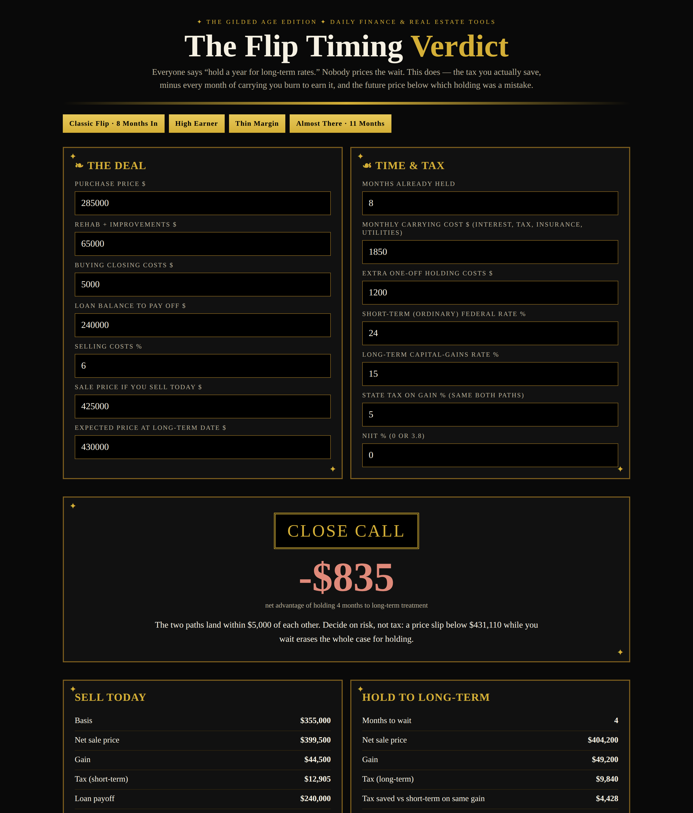

# The Flip Timing Verdict — Sell Now or Hold for Long-Term Gains?

**Live:** https://thebullbrew.github.io/flip-timing-verdict/
**Repo:** https://github.com/thebullbrew/flip-timing-verdict

## What it does

Prices the most repeated advice in flipping — "hold a year for long-term rates" — and finds out whether it's actually worth it on your deal. Enter basis, today's price, the expected price at the long-term date, your short-term vs long-term tax rates, and your monthly carrying cost. You get a HOLD FOR THE RATE / SELL NOW / CLOSE CALL / TAX TRAP seal, the tax actually saved, the carrying burned earning it, cash in pocket both ways, and the exact break-even future price below which waiting was a mistake. Includes a −10% to +10% future-price sensitivity table, a money-anatomy bar, 4 presets, saveable cases, and a copyable summary. On the defaults it lands at CLOSE CALL, −$835 — four months of carrying nearly eats the whole tax prize, which is exactly the point.

## The method

Basis = purchase + rehab/improvements + buying closing costs. Gain = net sale price (after selling costs) minus basis. Short-term gain is taxed at your ordinary rate; a sale after more than 12 months at your long-term rate. State tax and NIIT hit both paths equally, so they can't fake a saving. Holding cash subtracts every month of carrying plus one-off hold costs. The break-even future price is solved exactly by binary search. Not tax advice — dealer status, depreciation and brackets change real bills; confirm with your CPA.

## Design

Dark aesthetic variation 8 — Gilded Age: near-black background, thick gold rules, ornamental corners, huge gold serif hero numbers, gold-gradient buttons.

## How to run

Open `docs/index.html` in any browser, or serve `docs/` with any static host. Works offline as a PWA after first load. No backend, no accounts, no data leaves your device — saved cases live in localStorage.
